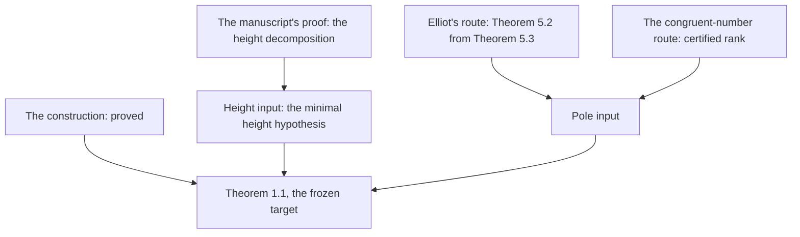

# Z is Diophantine in Q

This blueprint formalizes Theorem 1.1 of the 11/5 manuscript *ℤ is Diophantine in ℚ*:
an integer polynomial in 292,890,231,905 variables, of degree below $2\uparrow\uparrow 7$
and with coefficients below $2\uparrow\uparrow 8$, whose rational zero projection to the
first variable is exactly $\mathbb Z$.

The proof has one target, a construction and two inputs: the six-contact height estimate and pole
completeness. There are two routes to the pole input, and each gives a headline theorem. Both are
headlines; they are means to the same end.

## Status by route

| Route | Lean | Proved in that Lean | Assumed |
| --- | --- | --- | --- |
| [Elliot's route](main/main-theorem.md) | this fork's main, `ZInQ.OneProof.frozenTarget` | the construction; Theorem 1.1 from the two inputs; the height input from the open statements of [the height decomposition](height-decomposition/README.md); pole completeness from three inputs | the open statements of the height decomposition: published theorems, consequences of published theorems, statements from unrefereed sources and the manuscript's own claims, with only a few counted as published under the project's strict count; Theorem 5.3, the manuscript's own theorem, reduced in Lean to cited results and one structure of remaining hypotheses; the Cassels–Tate pairing on the curves $E_\ell$, as Poonen and Stoll restate Cassels' theorem (glue until re-cited and read); Silverman's rank-one implication (AEC, Appendix C, Evidence 16.5.5) |
| [The congruent-number route](main/main-theorem-reading-a-gross-zagier.md) | the tag `route-k-final` (`ZInQ.Contrib.GaussFE.frozenTarget_of_sixContactMin_tyzThm35ReadingA_grossZagier`) | at that tag: the construction, for a variant of the pole polynomial; Theorem 1.1 from the minimal height hypothesis and the certified rank hypothesis; that hypothesis from the two statements on the right | the minimal height hypothesis, whole; Tian–Yuan–Zhang's Theorem 3.5(2) in reading A, a reading that no refereed text found by the project states (glue); the Gross–Zagier statement, a consequence of Gross–Zagier with an auxiliary field and modularity |

[docs/one-proof/OPEN.md](https://github.com/Deicyde/diophantine-z-q/blob/main/docs/one-proof/OPEN.md)
lists every open statement of Elliot's route with its Lean statement, source and rating.

**The height input.** Both headlines assume the minimal form of the six-contact height estimate, the one
instance of the manuscript's Theorem 4.1 that the proof uses. It is not a published theorem: its proof
combines refereed theorems and exact computations with new arguments, the manuscript's and this
project's, reviewed only by AI models. [The height-decomposition chapter](height-decomposition/README.md)
derives it from statements of the literature. It may also be assumed in its $j$-form, a bound on the height
of the Hauptmodul value (not a published theorem) from which the minimal form is proved. A separate
project reaches an ineffective height estimate by another route
([a note on it](height-von-kanel-note.md)).

**Elliot's route to the pole input.** Pole completeness is the manuscript's Theorem 5.2: an explicit
polynomial, whose rational zeros put two points on curves $E_\ell:y^2=x(x-\ell)(x+3\ell)$, has a zero for
every suitably prepared input. The manuscript derives it from its restricted converse theorem
(Theorem 5.3) by a simultaneous 2-descent (Section 5.1), and so does the Lean:
`ZInQ.Manuscript.PoleS12.SilvermanRank.poleCompleteness_of_rankOne`. `ZInQ.OneProof.frozenTarget` takes
the three inputs of that derivation as its hypotheses `hRC`, `hCT` and `hRank`.

**The congruent-number route to the pole input.** A variant of the pole polynomial, for the congruent
number curves $C_\ell:y^2=x(x-\ell)(x+\ell)$, has pole completeness from the certified rank hypothesis,
which follows from Tian–Yuan–Zhang's Theorem 3.5(2) in reading A and from Gross–Zagier. Its Lean is kept
at the tag `route-k-final` and pinned upstream in elliotglazer/diophantine-z-q, and nasqret/z-in-q-lean
builds on it.

**The construction.** [An overview](construction.md) says what the polynomial is and why its rational
zeros project to $\mathbb Z$. Everything in it is proved, with every finite computation checked by the
Lean kernel. Two proofs depart from the manuscript: the bound for the prime catalogue follows from an
effective Dirichlet theorem, with a larger cutoff, and route AP replaces the manuscript's
twenty-two-prime pattern by long arithmetic progressions of good primes (Szemerédi's theorem in the
primes, from a Lean proof of the Green–Tao theorem, and a density theorem for those primes).

## How to read this book

Each part below opens with an overview page. Chapters are ordered as the proof uses them; within a
chapter, every page states one result, says what it depends on, and names its Lean declaration where
it has one. A page
marked as belonging to the congruent-number route has its Lean at the tag `route-k-final` unless it says
otherwise. The height-decomposition chapter is regenerated after each fold by
`scripts/one_proof/vault_chapter/gen.py`, from the Lean's open bundles, the project's ratings and
hand-written prose.

## Chapters

### Target and headlines

- [The main theorem and its hypotheses](main/README.md)

### The construction

- [Overview: the polynomial and why its zeros project to ℤ](construction.md)
- [The finite specification of the polynomial](syntax/README.md)
- [The elliptic model of integer indices](model/README.md)
- [Multiplication and the finite false-triple guard](multiplication/README.md)
- [Exact precision computation and polynomial compilation](compiler/README.md)
- [Assembly and the ordinary-value relation](assembly/README.md)
- [The cutoff and polynomial size](size/README.md)
- [Primes in arithmetic progressions](progressions/README.md)
- [Long progressions of good primes replace the prime pattern (route AP)](route-ap/README.md)
- [Szemerédi's theorem in the primes (Green–Tao)](green-tao/README.md)
- [The density of good slope primes (Proposition D)](density/README.md)

### The height input

- [Overview: the height input](height-input.md)
- [The minimal height hypothesis from the literature](height-decomposition/README.md)
- [An ineffective height estimate through von Känel's bound (nasqret/z-in-q-lean)](height-von-kanel-note.md)

### The pole input

- [Overview: the pole input](pole-input.md)

#### Elliot's route

- [Pole completeness from the restricted converse (Theorem 5.2 from Theorem 5.3)](pole-completeness-from-5-3/README.md)
- [The restricted converse (Theorem 5.3)](restricted-converse/README.md)

#### The congruent-number route

- [Pole completeness from certified rank](route-k/README.md)
- [The explicit system is the 2-Selmer group (Proposition 0)](selmer/README.md)
- [The row-5b determinant](rank-5b/README.md)
- [Rédei's formula for the 4-rank of class groups](redei/README.md)
- [The rank hypothesis as positive rank](rank/README.md)
